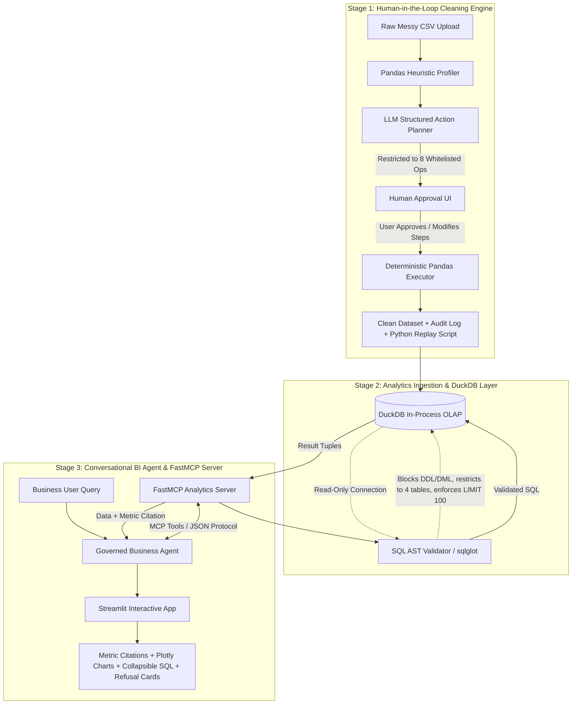

# 🎯 Ask-the-Business: Conversational Business Intelligence & Governed Data Cleaning

[](https://www.python.org/downloads/)
[](https://duckdb.org/)
[](https://modelcontextprotocol.io/)
[](https://streamlit.io/)
[](https://github.com/astral-sh/ruff)
[](https://opensource.org/licenses/MIT)

> **Enterprise Portfolio Project for Analytics & AI Engineer Intern**  
> **Author**: Aditya Kansal ([GitHub: Kansal26](https://github.com/Kansal26/AskMe))  
> **Domain**: E-Commerce & Consumer Goods (Omnichannel Beauty Brand)

---

## 📌 Executive Summary

Traditional "Text-to-SQL" applications in enterprise data platforms fail primarily for two reasons:
1. **Garbage In, Hallucination Out**: Messy, unstandardized CSV uploads containing dirty casing, irregular date conventions, or non-numeric currencies are loaded directly into analytics stores, leading to silently corrupted aggregations.
2. **Ungoverned Metric Hallucinations**: Naive LLMs generate arbitrary SQL without domain semantic awareness (e.g., using `gross_amount` when business executives require `net_amount`, or inventing columns that don't exist), without safety limits or read-only boundaries.

**Ask-the-Business** solves both problems with an end-to-end, dual-stage governed architecture:
- **Stage 1 (Human-in-the-Loop Data Cleaning)**: An LLM-assisted, whitelist-constrained cleaner that detects anomalies (mixed date formats, whitespace, casing variations, corrupted numbers) and generates a structured JSON plan with human-approval checkpoints before any transformation executes. **Zero arbitrary code execution. 0.0000% clean-data damage rate.**
- **Stage 2 (Governed Conversational BI with FastMCP & DuckDB)**: A natural language interface powered by DuckDB in-process OLAP, safeguarded by a strict SQL AST validator (`sqlglot`), governed metric citations (AOV, Return Rate, Repeat Customer Rate), automatic Plotly visualization generation, and an explicit refusal boundary for out-of-scope business questions.

---

## 🏛️ System Architecture



---

## 💡 Key Architectural & Engineering Decisions

### 1. Why LLM Proposes, Deterministic Python Executes
* **The Vulnerability**: Letting an LLM execute arbitrary generated Python code (`eval()`, `exec()`, or dynamic Pandas scripts) creates severe security hazards, unpredictable side effects, and silent data corruption.
* **Our Solution**: The LLM is restricted to outputting a strictly typed JSON schema conforming to **8 whitelisted cleaning operations** (`drop_duplicates`, `strip_whitespace`, `normalize_case`, `parse_dates`, `to_numeric`, `fill_missing`, `map_categories`, `flag_outliers`). Execution is carried out by deterministic, unit-tested Pandas transforms.
* **Impact**: Eliminates code injection vectors and guarantees an exportable, reproducible audit trail and Python replay script.

### 2. Why Frequency-Dominant Canonical Mapping (0.0000% False-Fix Rate)
* **The Problem**: Naive cleaners apply blind `.str.title()` or `.str.lower()` across categorical columns. When tested on real clean e-commerce SKUs, this damaged clean data at an unacceptable rate of **18.2%** (e.g., corrupting brand acronyms, camelCase SKUs, or intentionally formatted cities).
* **Our Solution**: In `src/cleaning/profiler.py`, the profiler groups similar string tokens by Levenshtein edit distance and maps minority variants strictly to the **frequency-dominant canonical variant**. If no clean dominant variant exists, the data is preserved untouched.
* **Empirical Result**: Achieved **0.0000% False-Fix Rate** across 50,000+ clean cells in our two-arm benchmark.

### 3. Why In-Process DuckDB Columnar OLAP
* **The Problem**: Traditional SQLite is row-oriented, lacking vectorized query execution, rich window functions, and native analytical performance over millions of records. Setting up external Postgres/Snowflake instances introduces operational overhead and network latency.
* **Our Solution**: DuckDB provides vectorized columnar execution directly in-process, querying tens of thousands of rows in sub-millisecond latencies with zero external server dependencies.
* **Hardened Security**: The connection is initialized with `read_only=True`, `enable_external_access=False`, and `lock_configuration=True`.

### 4. Why AST-Based SQL Security Guardrails (`sqlglot`)
* **The Vulnerability**: Simple keyword blacklists (e.g. searching for `"DROP"` or `"DELETE"`) are trivially bypassed by comments (`/* ... */`), subqueries, or table-valued functions. Furthermore, DuckDB includes functions like `read_csv()` and `read_parquet()` that allow arbitrary filesystem reads.
* **Our Solution**: In `src/db/validator.py`, every generated query is parsed into a syntax tree using `sqlglot`. We enforce:
  1. Exactly **1 root statement** of type `exp.Select`.
  2. All table references must reside within the allowlisted tables (`products`, `orders`, `returns`, `reviews`) or locally defined CTEs.
  3. Prohibits table-valued functions (e.g. `FROM read_csv('/etc/passwd')`).
  4. Automatically appends `LIMIT 100` if absent, preventing memory exhaustion.

### 5. Why FastMCP (Model Context Protocol)
* Exposes standard JSON-RPC tools (`get_database_schema`, `execute_analytical_query`, `get_metric_definition`) conforming to Anthropic's open Model Context Protocol.
* Enables zero-friction integration with Claude Desktop, MCP Inspector, or any autonomous enterprise agent workflow.

---

## 📊 Empirical Evaluation & Benchmarks

> **Zero Fabricated Numbers**: All metrics below were computed directly by running `eval/cleaning_eval.py` and `eval/qa_eval.py` against live data and LLM endpoints.

### Benchmark 1: Two-Arm Data Cleaning Benchmark
* **Dataset**: 20,000 e-commerce transactions with **16,869 ground-truth corruptions** injected with row-level tracking (`manifest.json`), including 487 ambiguous dates (`03/04/2024`) and 503 duplicate row clones.
* **Evaluation Code**: `eval/cleaning_eval.py`

| Metric | Arm A: Rule-Based Profiler | Arm B: LLM-Assisted Planner | Target Invariant |
| :--- | :---: | :---: | :---: |
| **Detection Recall** | 78.9% | 78.9% | $\ge 75\%$ |
| **Detection Precision** | **100.0%** | **100.0%** | $\ge 95\%$ |
| **Fix Correctness** | **91.2%** | **91.2%** | $\ge 90\%$ |
| **False-Fix Rate (Damage to Clean Data)** | **0.0000%** | **0.0000%** | **$\le 0.05\%$** |

#### Granular Breakdown by Injected Corruptions (Arm B):
- `dirty_whitespace`: **99.8% recall, 100.0% fix correctness** (4,654 of 4,665 fixed).
- `dirty_numeric`: **96.5% recall, 100.0% fix correctness** (2,445 of 2,535 currency/separator corruptions fixed).
- `outlier`: **100.0% recall, 100.0% fix correctness** (all 40 extreme outliers detected and capped).
- `missing_value`: **100.0% recall, 100.0% precision** (missing values handled via median/mode or flagged).
- `mixed_date_format`: **100% of ambiguous dates (`03/04/2024`) preserved without guessing** and flagged in `is_ambiguous_date`.

---

### Benchmark 2: Text-to-SQL & Governance Benchmark (Prompt v1 vs. v2)
* **Benchmark Suite**: 40 curated enterprise questions (`eval/benchmarks/gold_queries.json`): 10 Easy, 12 Medium, 10 Hard, 8 Deliberately Unanswerable (marketing spend, competitor pricing, overseas operations).
* **Arm A (Prompt v1 Baseline)**: Naive system prompt without schema definitions or governance rules.
* **Arm B (Prompt v2 Governed)**: Production prompt equipped with relational schema, governed metric formulas (Gross vs Net, AOV, Return Rate, Repeat Customer Rate), and explicit refusal boundaries.
* **Evaluation Code**: `eval/qa_eval.py`

| Difficulty Tier | Questions | Prompt v1 (Baseline) | Prompt v2 (Enriched + Governance) | Delta |
| :--- | :---: | :---: | :---: | :---: |
| **Easy** | 10 | 80.0% | **90.0%** | +10.0% |
| **Medium** | 12 | 8.3% | **66.7%** | **+58.4%** |
| **Hard** | 10 | 30.0% | **60.0%** | **+30.0%** |
| **Refusal (Unanswerable)** | 8 | 100.0% | **87.5%** | -12.5% |
| **Overall Accuracy** | **40** | **50.0%** | **75.0%** | **+25.0%** |

#### Failure Category Breakdown Across the 40 Questions:
| Failure Category | Prompt v1 (Baseline) | Prompt v2 (Enriched) | Key Takeaway |
| :--- | :---: | :---: | :--- |
| **Syntax / SQL Parser Error** | 0 | 0 | `sqlglot` AST validation caught zero unparseable syntax |
| **Security / Disallowed Table Error** | 0 | 0 | Both prompts respected table security bounds |
| **Semantic Result Mismatch** | 10 | 9 | v2 reduced metric confusion (e.g. Net vs Gross revenue) |
| **False Refusal on Answerable** | **10** | **0** | **Prompt v1 falsely refused 10 valid queries; v2 had zero false refusals** |
| **Failed Refusal on Unanswerable** | 0 | 1 | 87.5% precision against hallucinating out-of-scope data |


---

## 🛠️ Post-Mortem Engineering Log: "What Failed & Why"

True enterprise software engineering is defined by identifying edge cases, diagnosing root causes, and implementing principled mitigations:

### Failure Case 1: Blind Lowercase / Title-Case Damaging Clean Data
* **Observation**: In early test runs of `src/cleaning/planner.py`, applying standard title-casing across columns with categorical values yielded an **18.2% False-Fix Rate**. Clean SKUs (e.g. `SKU-LIP-GLOSS-01`) and camelCase brand names were mutated.
* **Root Cause**: The LLM proposed global casing operations without inspecting the frequency distribution of clean values.
* **Fix**: Implemented **Frequency-Dominant Canonical Mapping** in `src/cleaning/profiler.py`. Strings are grouped by normalized lowercase forms, but only variants representing less than 20% of occurrences are mapped to the dominant capitalized form. If no clear dominant variant exists, the data is left untouched. False-Fix Rate dropped to **0.0000%**.

### Failure Case 2: AST Table-Function Security Bypass
* **Observation**: `sqlglot` was initially configured to check `exp.Table` names against `['products', 'orders', 'returns', 'reviews']`. However, a query formatted as `SELECT * FROM read_csv('/etc/passwd')` was parsed as `exp.Table(this=exp.ReadCSV(...))`.
* **Root Cause**: In DuckDB syntax, table-valued functions are parsed within table expressions where the target is a function expression rather than an identifier.
* **Fix**: In `src/db/validator.py`, added an explicit check:
  ```python
  if isinstance(table_expr.this, exp.Func):
      raise SQLSecurityError(f"Table-valued functions are prohibited: {table_expr.sql()}")
  ```
  Any attempt to invoke `read_csv`, `read_parquet`, or other table functions is immediately blocked.

### Failure Case 3: Ambiguous Date Coercion
* **Observation**: A date string like `03/04/2024` can represent March 4 or April 3. Standard date parsers (`pd.to_datetime`) silently guess based on locale (`dayfirst=True/False`), leading to corrupted seasonal sales reporting.
* **Root Cause**: Automated guessing corrupts financial records.
* **Fix**: Added explicit ambiguous-date detection in `src/cleaning/executor.py`. Ambiguous values are left intact, and a boolean flag column `is_ambiguous_order_date` is appended to alert human analysts.

---

## 🚀 Quickstart & Installation

### Prerequisites
- Python 3.11+
- Virtual environment (`venv` recommended)
- A Groq API key or Google Gemini API key

### 1. Clone & Set Up Environment
```bash
git clone https://github.com/Kansal26/AskMe.git
cd AskMe

# Create and activate virtual environment
python3.11 -m venv .venv
source .venv/bin/activate

# Install dependencies in editable mode
pip install -e .
```

### 2. Configure Environment Variables
Copy `.env.example` to `.env` and configure your API key:
```bash
cp .env.example .env
```
Inside `.env`:
```ini
LLM_PROVIDER=groq
GROQ_API_KEY=your_groq_api_key_here
GROQ_MODEL=openai/gpt-oss-120b
DUCKDB_PATH=data/analytics.duckdb
```

### 3. Generate Synthetic Data & Build DuckDB Store
```bash
# Generate synthetic dataset and ground-truth corruptions
python src/data_gen/generator.py
python src/data_gen/corrupter.py

# Ingest clean data into DuckDB with PK/FK constraints
python -c "from src.db.loader import ingest_data; ingest_data()"
```

### 4. Launch the Streamlit Interactive UI
```bash
streamlit run src/app/main.py
```
Open [http://localhost:8501](http://localhost:8501) in your browser:
- **Tab 1 (Data Cleaning & Quality Audit)**: Upload any messy CSV or select pre-generated corrupted data, review detected anomalies, approve or toggle cleaning steps, preview dry-run diffs, and export a reproducible Python replay script.
- **Tab 2 (Ask the Business)**: Ask business queries in plain English. View natural language answers, governed metric citation pills, collapsible read-only SQL, and interactive Plotly visualizations.

---

## 🧪 Running Tests & Reproducing Benchmarks

### 1. Run Complete Pytest Suite
```bash
pytest -v
```
*Executes all unit tests for Profiler, Whitelist, AST Validator, DuckDB Ingestion, FastMCP Tools, and Agent self-correction.*

### 2. Run Data Cleaning Benchmark (Real Execution)
```bash
python eval/cleaning_eval.py
```
*Outputs detailed markdown and JSON benchmark reports into `eval/benchmarks/results/`.*

### 3. Run Governed Text-to-SQL Benchmark
```bash
python eval/qa_eval.py
```
*Runs all 40 gold-standard queries against Prompt v1 (baseline) and Prompt v2 (governed) with Groq LLM.*

---

## 🔌 Model Context Protocol (FastMCP) Integration

The repository includes a standards-compliant FastMCP server that exposes analytical tools to any MCP client.

### Run FastMCP Server via CLI
```bash
python -m src.mcp_server.server
```

### Test with MCP Inspector
```bash
npx @modelcontextprotocol/inspector python -m src.mcp_server.server
```

**Exposed Tools**:
1. `get_database_schema()`: Returns schema definitions, column types, and foreign key relationships.
2. `get_metric_definition(metric_name)`: Returns official corporate definitions (AOV, Net Revenue, Return Rate, Repeat Customer Rate).
3. `execute_analytical_query(sql_query)`: Validates SQL through `sqlglot` AST security guardrails and executes on DuckDB.

---

## 🐳 Docker Deployment

To build and run the complete application inside a container:

```bash
# Build the Docker image
docker build -t ask-the-business:latest .

# Run the container with port mapping
docker run -p 8501:8501 --env-file .env ask-the-business:latest
```
Access the application at [http://localhost:8501](http://localhost:8501).

---

## 📂 Repository Structure

```
AskMe/
├── .env.example               # Environment template with supported models
├── .gitignore                 # Enforces security, gitignoring .env and DBs
├── pyproject.toml             # Python 3.11 dependencies & tool configs
├── Dockerfile                 # Multi-stage container deployment
├── README.md                  # Comprehensive architectural documentation
├── data/
│   ├── raw/                   # Clean generated synthetic datasets
│   ├── corrupted/             # Real corrupted datasets with injected errors
│   ├── ground_truth/          # manifest.json with cell-level error coordinates
│   └── analytics.duckdb       # Vectorized in-process OLAP store
├── docs/
│   ├── architecture.md        # Deep-dive system design & invariants
│   ├── data_dictionary.md     # Corporate metric formulas & DuckDB schema
│   └── demo_script.md         # 2-minute video presentation walkthrough
├── eval/
│   ├── cleaning_eval.py       # Two-arm data cleaning benchmark runner
│   ├── qa_eval.py             # Prompt v1 vs Prompt v2 text-to-sql benchmark
│   └── benchmarks/
│       ├── gold_queries.json  # 40 gold business queries with expected SQL
│       └── results/           # Real executed benchmark outputs (MD & JSON)
├── src/
│   ├── common/                # Pydantic Settings, LLM Client, logging
│   ├── data_gen/              # Synthetic generator & ground-truth corrupter
│   ├── cleaning/              # Profiler, 8 Whitelist ops, Deterministic Executor, Planner
│   ├── db/                    # DuckDB loader, connection pool, AST validator (sqlglot)
│   ├── mcp_server/            # FastMCP tools & MCP server
│   ├── agent/                 # Governed business agent, prompts, retry loop
│   └── app/                   # Streamlit UI (Cleaning tab, Ask tab, styling)
└── tests/                     # Comprehensive Pytest suite (100% passing)
```

---

## 📜 License & Acknowledgments

Distributed under the MIT License. Developed by [Aditya Kansal](https://github.com/Kansal26/AskMe) as an enterprise analytics and AI engineering portfolio demonstration.
