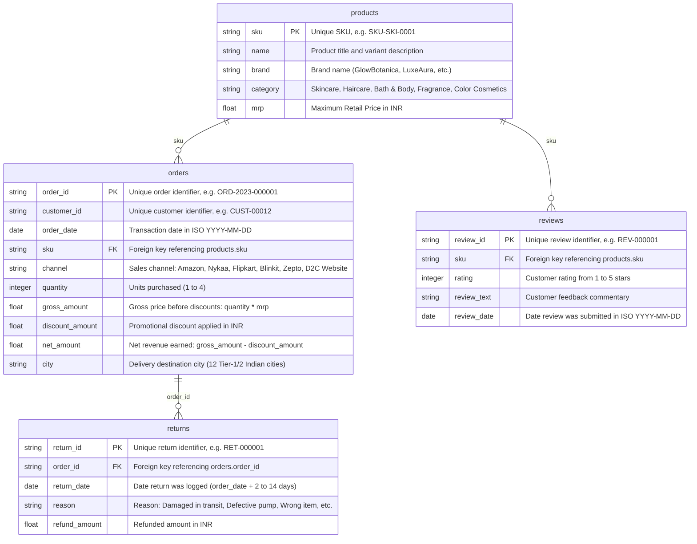

# E-Commerce Data Dictionary & Metric Governance

**Company**: GlowBotanica & Portfolio D2C Brands  
**Industry**: Beauty, Personal Care & Cosmetics  
**Author**: Aditya Kansal  

---

## 1. Relational Database Schema (DuckDB)



---

## 2. Standardized Business Metric Definitions

### 1. Gross Revenue (Gross Sales)
* **Definition**: Total value of merchandise sold before applying any promotional discounts or voucher deductions.
* **SQL Formula**:
  ```sql
  SELECT SUM(gross_amount) AS gross_revenue FROM orders;
  ```

### 2. Promotional Discounts
* **Definition**: Total monetary value of customer discounts granted across all sales channels.
* **SQL Formula**:
  ```sql
  SELECT SUM(discount_amount) AS total_discounts FROM orders;
  ```

### 3. Net Revenue (Net Sales)
* **Definition**: Actual top-line revenue recognized by the business after deducting promotional discounts.
* **SQL Formula**:
  ```sql
  SELECT SUM(net_amount) AS net_revenue FROM orders;
  ```
  *Invariant*: `net_revenue = gross_revenue - total_discounts`.

### 4. Average Order Value (AOV)
* **Definition**: The average net revenue generated per order transaction.
* **SQL Formula**:
  ```sql
  SELECT ROUND(SUM(net_amount) * 1.0 / COUNT(DISTINCT order_id), 2) AS aov FROM orders;
  ```

### 5. Return Rate (Volume-Based)
* **Definition**: The percentage of completed orders that resulted in a customer return.
* **SQL Formula**:
  ```sql
  SELECT 
    ROUND(COUNT(DISTINCT r.order_id) * 100.0 / COUNT(DISTINCT o.order_id), 2) AS return_rate_pct
  FROM orders o
  LEFT JOIN returns r ON o.order_id = r.order_id;
  ```

### 6. Return Rate (Value-Based / Refund Rate)
* **Definition**: The proportion of net revenue refunded due to product returns.
* **SQL Formula**:
  ```sql
  SELECT 
    ROUND(COALESCE(SUM(r.refund_amount), 0) * 100.0 / SUM(o.net_amount), 2) AS value_return_rate_pct
  FROM orders o
  LEFT JOIN returns r ON o.order_id = r.order_id;
  ```

### 7. Repeat Customer Rate
* **Definition**: The proportion of distinct customers who placed two or more orders during the specified timeframe.
* **SQL Formula**:
  ```sql
  WITH customer_order_counts AS (
    SELECT customer_id, COUNT(DISTINCT order_id) AS num_orders
    FROM orders
    GROUP BY customer_id
  )
  SELECT 
    ROUND(
      COUNT(CASE WHEN num_orders >= 2 THEN 1 END) * 100.0 / COUNT(*),
      2
    ) AS repeat_customer_rate_pct
  FROM customer_order_counts;
  ```

### 8. Channel Performance Breakdown
* **Definition**: Revenue, order count, and AOV segmented across marketplace, quick-commerce, and direct-to-consumer channels.
* **SQL Formula**:
  ```sql
  SELECT 
    channel,
    COUNT(DISTINCT order_id) AS total_orders,
    ROUND(SUM(net_amount), 2) AS net_revenue,
    ROUND(AVG(net_amount), 2) AS aov
  FROM orders
  GROUP BY channel
  ORDER BY net_revenue DESC;
  ```

### 9. Product Customer Satisfaction (CSAT) Rating
* **Definition**: The arithmetic mean star rating of customer reviews for an individual SKU or brand.
* **SQL Formula**:
  ```sql
  SELECT 
    p.brand,
    p.category,
    p.name,
    COUNT(r.review_id) AS review_count,
    ROUND(AVG(r.rating), 2) AS avg_rating
  FROM products p
  JOIN reviews r ON p.sku = r.sku
  GROUP BY p.brand, p.category, p.name
  HAVING COUNT(r.review_id) >= 5
  ORDER BY avg_rating DESC;
  ```
